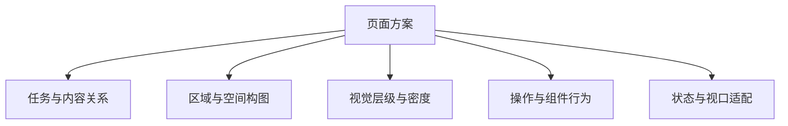

# Beauye 页面设计

把用户任务、内容关系、空间、视觉和行为组成一个整体页面方案。适用于页面生成、改版与 UI 评审；纯 API、数据库或构建任务使用其自身流程。

每次形成或修改页面，先应用[文字与元素密度](references/density.md)：删除重复表达及其容器，为必要信息选择可见、按需帮助或确认时呈现。控制文字、区块和装饰的数量，不能只减少字数。

实现交互前应用[成熟组件复用](references/component-reuse.md)，检查项目已有组件与真实依赖。优先复用成熟控件的状态、焦点和键盘行为，再组合业务界面；不要只模仿组件库外观。组件复用与低密度同时成立。

## 按任务工作

先确认用户要查看、比较、判断和完成什么，再读取项目的同类页面、业务组件、组件库、设计变量、路由、权限和设备支持。区分已知事实与假设；能够从项目确定的信息自行检查，只有影响方案的缺失信息才需要澄清。

遵守当前用户要求和明确的项目约束，应用[技术选型](references/technology.md)，再借鉴参考。存量技术栈的迁移范围由当前任务决定。仅设计时交付方案；仅评审时交付具体问题与建议；已授权新增或修改时形成方案后继续实施。

## 形成同一个页面方案

新增页面类型或明显重做布局时，读取[页面方案](references/page-plan.md)和[布局与内容](references/layout-and-content.md)。先确定区域、阅读顺序、主要操作位置和必须同时可见的信息，再编码。小改动复用已有决定，不强制重做整份方案。

比较关系约束字段可见性、呈现形式、对齐和窄屏组织；操作对象约束位置、视觉权重与反馈。局部调整时检查这些关系，避免每个区块分别合理而整页失衡。

<!-- 局部布局摘录曾放过整页冗余；先审查外壳与正文的关系，再处理本次专项。 -->
把应用外壳与正文放在同一方案中检查。侧栏、顶栏、账户、统计、工具栏、数据和尾栏都要有任务用途。用户反馈先区分已有规则未执行、局部指导未覆盖和新增业务要求，再修订对应决定。具体页面的三卡样式、账户位置和分页要求记录适用范围，不变成所有页面的固定模板。

用简短草图与必要理由表达方案。复杂任务可复用[页面方案模板](assets/page-plan.md)及[示例](references/examples.md)，已有任务记录能表达时直接沿用。用户不需要学习模板或填写配置。

面向人展示时，页面结构、关系和选择优先用 Mermaid、线框或图片表达，正文只保留任务、关键取舍与交接信息。能够画图的信息不要改写成说明表格；完整字段、状态和检查细则放入按需展开的部分或已有任务记录，保留条件与例外。模板用于保存信息，不要求把全部字段铺到回答中。

## 按涉及的决定读取

- 文案、层级、密度、区域和响应式：读[布局与内容](references/layout-and-content.md)。保留比较能力和必要条件，减少重复表达。
- 控件、表单、导航、弹层、状态与动效：读[组件与状态](references/components-and-states.md)。同时确定真实行为、输入恢复与焦点。
- 图标、SVG、图片或 3D：读[图标与素材](references/assets.md)。普通无素材变更任务不需要生成图片。
- 组件选型、新项目或依赖变化：读[技术选型](references/technology.md)。区分默认栈、存量兼容、按需能力与参考来源。
- 缺少已确认同类页，或新增类型、明显改版：读[视觉参考](references/visual-references.md)，选 1–2 个具体对象，说明借鉴关系。

## 交付与执行衔接

按照[交接约定](references/handoff.md)，把任务、设计决定、适用条件与待验证项交给执行阶段。可用时使用 `$beauye-execution`，也可由当前 Harness 使用项目已有工具执行同样检查；设计 Skill 可独立形成方案。

页面形成后，可用 `$beauye-review` 从用户任务和当前产物独立检查内容取舍、层级、操作归属与真实交互。审查建议交给执行阶段处理；涉及区域、信息或操作关系改变时回到本方案。专项通过、组件复用和审美判断分别记录。

修改范围与检查范围分别记录。默认从路由、导航、权限建立完整页面清单，真实浏览器检查全部页面主要桌面视口；修改及受影响页面补查 1440×900、1280×800，支持移动端时再查约 390px。只有用户明确要求时才缩小检查范围。

设计意图与实测结果分开。仅有方案、截图文件或构建通过，不能证明全部交互和视觉已通过。交付简短说明关键取舍、实际完成内容、检查结果及未验证原因；详细记录留在开发资料中，页面只呈现业务内容。
