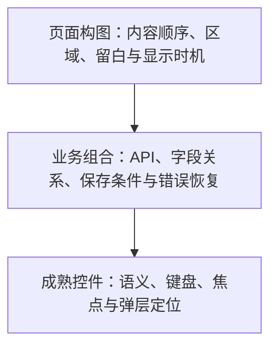

# 成熟 UI 组件复用

实现控件前先读取本文件。组件复用决定交互实现来源；页面的信息、区域和显示时机仍由[密度规则](density.md)决定。

## 先查真实工程

读取包清单、锁文件、组件目录和当前页面的 import，确认框架、库版本、实际导出与主题。查找一个真实使用样例，核对组件是否兼容现有表单、路由和样式系统。依赖已安装、组件同名或外观相似，都不能证明已复用。

按以下顺序选择实现：

已有业务组件覆盖当前任务时直接使用。否则从工程已有的成熟基础库选择控件，用它们组合业务内容；只有真实需求未覆盖时才定制缺口。先查组件的官方 API、安装方式和版本，再编写调用；避免凭记忆编造 props。

新项目采用既定栈 Vite、React、TypeScript、Base UI、Tailwind CSS 与 shadcn/ui 的 Base UI 版本。shadcn/ui 的可编辑源码封装也属于复用，前提是保留可核对的官方来源，并实际调用底层 Base UI。存量工程已有 Ant Design、Radix UI、MUI 等兼容方案时继续沿用，按现有版本使用；单页调整不构成迁移组件库的理由。纯 HTML 工程的局部修订同样遵循其现有约束，另建新项目时再采用新项目栈。

## 分清职责

页面构图按真实任务取舍可见文字，不直接复制库示例中的 Card、标题和说明。业务组合处理危险操作及恢复条件，把焦点圈、键盘切换和弹层定位交给成熟控件。Button、Switch、Dialog、Tooltip/Popover、Form 的语义和交互不会自动产生常驻提示、统计、记录列表或额外容器。

基础控件可以用 Tailwind 和项目 token 调整尺寸、颜色与排布。样式改写不等于重写控件行为。调整尺寸后检查所有适用状态的实际几何，例如 Switch 开启和关闭时的圆点都应处于轨道内；仅核对 `aria-checked` 无法发现样式偏移。多个控件可以处于同一个页面区域，不必各包一张卡片。

<!-- 选项指示器按状态卸载时，自动网格曾把未选文字挤进图标列；状态变体需一起验证。 -->
组件的可选部分可能随状态挂载或卸载。检查选中、未选中、禁用和长标签，使用明确槽位或稳定容器保持布局；不要假定每种状态都有相同数量的子节点。菜单能选择不等于每个选项都可读。

Button、Switch、选择器、菜单、Tooltip/Popover、Dialog、表单等优先使用现有成熟实现。Dialog 的模态与焦点圈、菜单的键盘移动、Switch 的键盘切换、弹层的碰撞定位等复杂交互交给库；不要手写一套仅外观相似的同名控件。业务代码只补当前任务确实需要的状态和结果。

Tooltip 用于补充视觉标签，并给触发器独立的可访问名称。条件帮助应使用可访问的 Popover，复用 `openOnHover` 等官方交互 API，覆盖键盘聚焦与触屏点击。先核实实际库版本的语义；例如 Base UI 1.9 的 Tooltip 是视觉提示，不能假定它带有 `role="tooltip"` 或替代读屏说明。复用库的触发器组合 API，不套叠两个按钮。帮助触发器独立于字段标签；打开、关闭、聚焦和触屏点击均不能误切换字段或提交表单。

## 验证真实复用

沿页面入口追踪到本地组件封装，再到包中的真实控件；核对锁文件与生产构建，打开构建后的页面验证语义和行为。包声明或静态 import 只是证据的一部分，还要证明该组件实际渲染并参与操作。

覆盖适用状态：加载与禁用、提交防重复、失败保留输入、Switch 键盘切换、Dialog 焦点圈及关闭后返回、帮助的鼠标／键盘／触屏交互。删除后若入口禁用，用库的焦点返回 API 指向现有控件或结果状态。不要为管理焦点增加记录列表或标题。

受控 Dialog 没有关联 Trigger 时，显式使用库的返回焦点接口指定当前入口，避免卸载副作用与库的恢复逻辑争夺焦点。复验先关闭一个弹窗、再打开并取消另一个弹窗，不能只检查各自的独立初始状态。

<!-- 带 native 属性的非原生节点曾无法响应空格；配置名不能代替最终 DOM 和操作。 -->
检查最终渲染节点和事件。声明原生按钮语义时，实际节点与组件 API 的约定必须一致；焦点能进入不等于空格或回车能触发。上传弹窗验证真实焦点约束和取消，数据表验证实际列宽、滚动与跨页状态；不因为包名或外观正确就跳过操作。

组件复用的验证和密度验证分别记录。真实使用组件库不能抵消多余文字和容器；低密度也不能抵消失效的交互。交付时记录组件来源、实际版本、定制范围和真实验证结果，不把已安装依赖写成已完成复用。

官方入口：[shadcn/ui Vite 安装](https://ui.shadcn.com/docs/installation/vite)、[shadcn/ui Base UI 文档](https://ui.shadcn.com/docs/changelog/2026-01-base-ui)、[Base UI](https://base-ui.com/react/overview/quick-start)。实现时重新核对当前工程实际版本。
