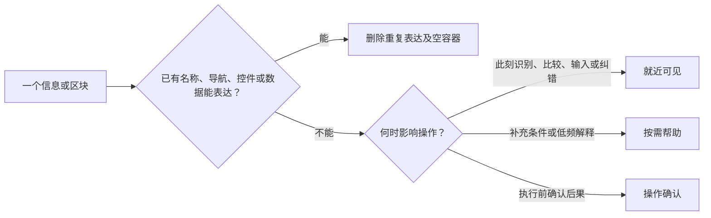

# 文字与元素密度

每一段可见文字、图标、边框和区块都占用注意力。先决定是否需要，再选择表达；不要为了填满页面添加内容。

## 删除文字时一起删除元素

<!-- 旧页面已有的列表会被误当成任务要求；改版时先用当前任务核对区域，防止无关区域随源码继承。 -->
从当前任务列出必须查看、比较、填写和执行的内容，再核对旧页面。旧页面是实现资料，已有区域不是新增需求。没有当前任务用途的列表、数量、标题、边界与容器整段移除；只要求删除记录时，不自行保留记录浏览列表，也不把它替换成记录概况卡。

删除标题后，移除只为标题存在的页头、分隔线、留白和容器。不要用另一句摘要、装饰图标、统计卡或空白区补回。区域数、嵌套层数和主内容起始位置与字数一起检查；不靠缩小字体、压低行高或隐藏关键数据获得减量。

侧栏当前项已经定位列表时，通常直接呈现工具栏与数据，不再叠加同义页标题、面包屑和表格标题。只有层级跳转、独立访问或对象识别确有需要时保留相应入口。详情展示订单号等对象身份，不添加泛化的“详情”标题。标题可用屏幕阅读器专用名称保留结构，无需增加可见区域。

<!-- 冗余曾跨越外壳与正文而未被发现；去重需要覆盖整页，而非逐组件计字。 -->
同时核对侧栏工作区介绍、导航组名、菜单计数、顶栏路径、静态联网状态、账户文案和页脚。相同信息只在能支持任务的位置呈现。真实工作区切换、待处理数量、当前筛选、离线错误和必要账户身份仍保留；静态“网络已连接”不作为默认装饰。账户展示已有资料字段，缺少姓名时明确样例数据或缺失状态，不从头像字母推测身份。

表格、表单和列表已能识别自身时，不另加“订单列表”“保存与提醒”等标题。统计卡、说明区、页脚、徽标和背景容器需要独立任务依据，不能为了构图完整而添加。内容自然结束；短任务不强制铺满视口，长数据按业务需要滚动，不按侧栏长度裁切。

## 为剩余信息选位置

- 识别对象、填写字段、比较状态、当前筛选、实际错误与恢复入口保持可见。不可用原因影响当前选择时，在相关操作处可发现。
- 控件已表达的状态不复述。Switch 以滑块位置、轨道形状和 checked/aria-checked 表达状态，颜色辅助；通常省去“开启／关闭”。字段名称仍可见。
- 补充条件放在邻近的帮助触发器中；仅当确有补充信息时添加帮助图标。Tooltip 用于短说明，支持 hover 与 focus；触屏可点按展开并关闭。长说明、链接或可操作内容使用 Popover。不得把必要字段、当前错误或核心比较数据藏进提示。
- 删除等高影响操作在确认 Dialog 中说明对象、范围和不可恢复后果，提供取消与明确确认。警告不必重复常驻；若后果在用户作选择前就会改变方案，仍要及时呈现该条件。

<!-- “影响选择”曾被解释成所有条件都常驻，压过按需帮助；明确当前任务必需与补充限制的区别。 -->
触发时机、频率等补充限制可能影响偏好选择，但不因此一律常驻。设置名称足以识别功能时，用邻近帮助提供这些限制；只有当前有效输入、错误恢复或不可逆选择必需的条件直接显示。例如自动保存只在网络恢复时执行的条件放入帮助，真正离线或保存失败时再直接显示当前情况与恢复动作。

## 控件与图标

熟悉且语义明确的删除、编辑、搜索、星标等动作优先使用语义 SVG 图标按钮，配可访问名称、hover/focus 提示和足够命中区域。不要同时堆叠图标、动作文字与动作解释。陌生或易歧义动作保留短文字；主要操作按辨识需要选择短标签，不把所有按钮机械改成图标。

列表中逐行重复的“项目文件”等副标题，只有补充区分对象所必需的信息时保留。搜索提示只说明实际可搜索的内容；筛选与排序入口可用熟悉图标，但当前生效条件和方向仍能被识别，不以减量隐藏状态。

<!-- 只替换按钮文字曾留下卡片外的孤立删除图标；图标化必须连同操作归属一起重新审查。 -->
文字换成图标后，重新检查位置、分组、主次和对齐。区块操作留在所属区域的操作栏中，与主要操作保持清楚的权重与间距；不沿用已删除内容下面的空白位置。例：设置页移除保存记录列表后，把删除图标纳入设置卡片的操作区，不让它单独漂在卡片外。

复用项目 Button、Switch、Tooltip/Popover、Dialog 等真实组件；不能用 emoji、颜文字或文字字符充当图标。已有 SVG 足够时直接使用，简单业务变化编辑矢量，复杂素材才考虑 imagegen。

<!-- 说明按钮放进整行 label 容易误切换设置；显式分开两个交互目标，适用于带帮助的表单控件。 -->
帮助按钮与字段标签分别交互，点击帮助不切换 Switch、不提交表单。hover、focus、触屏点击应能获得同一补充信息，提示可关闭；关闭后焦点与设置状态保持合理。按桌面和触屏分别检查实际命中范围、相邻控件间距及遮挡，不为满足固定大尺寸而扩大整行和区块。

## 在页面上检查

正常、hover/focus、触屏帮助、确认和失败状态分别观察。逐项检查：重复表达是否真正移除；说明是否在需要时可发现；危险操作是否先确认；文字减少后是否仍有空容器、多余区域或失去归属的操作；比较、键盘和触屏任务是否仍能完成。字数与元素计数用于定位，真实任务和截图决定取舍。
