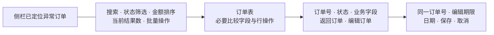

# 页面方案示例

以下为设计提案，用于校准决定的具体程度，不代表已生成页面或已经测试。

## 订单异常列表

任务是跨行比较客户、金额、状态、异常原因与处理期限，搜索、筛选、排序并批量处理，还能进入订单详情和编辑期限。项目已有 Ant Design 和紧凑业务表格，沿用其组件和样式约定。

侧栏已定位列表，主区直接呈现工具栏与数据。重复面包屑、页标题、表格标题及只承载它们的容器一并删除；全量总数、待处理数和金额汇总没有独立判断用途，因此不另设统计区。筛选后的结果数放在工具栏，表格后只保留实际需要的选择与处理操作，不补常驻提醒、静态工作区尾栏或页脚。分页只在数据确实跨页时出现。

表格取得主要面积，筛选沿其共同边缘对齐。金额统一格式并靠右，状态有文字与颜色。批量操作清楚表达选中范围，单笔处理紧随对应订单。沿用字号、圆角和间距变量，行高随内容与操作需要安排；不以缩字、裁切或空白撑高换取整齐。

详情保留订单号、状态、客户、金额、原因、期限、返回与编辑入口；编辑页保留同一对象身份、期限字段、保存和取消。泛化的“订单详情”“订单信息”不再各占一层。直接访问详情或编辑时仍能识别对象和返回列表，不能因为列表已有导航就删掉业务身份。

搜索、筛选、排序和处理均需真实行为；提交防重，失败保留输入与选择。无匹配结果就近提供清除筛选等恢复入口，不保留空的列表标题或无用操作容器。长客户名和异常原因完整换行或有可达的完整入口；手机保留全部比较字段，仅表格容器横向滚动。粘性批量栏在真实视口中滚动检查，末行订单号、选择框和期限入口均能完整操作。

本例修改列表、详情、期限编辑及其共享壳。检查默认仍整理全站清单并检查主要桌面视口，相关页面补查规定桌面与手机视口；同时观察移除文字后是否残留空容器。没有角色或浏览器时记录未验证，不能把方案描述作为操作证据。

## 审核详情

任务是同时比较申请资料与政策依据，再批准或退回。两组信息共同支持判断，因此采用主辅并排区域；对象与状态在页头，审核动作靠近判断上下文。把关键依据放到互斥 Tab 会中断比较。

正文可读，相关字段邻近，低频记录按需展开。退回原因输入有标签，错误贴近字段，需确认的后果进入确认弹窗。较窄视口可上下重排并保持合理阅读与焦点顺序；若任务仍需同时比较，需要保留切换成本低且内容完整的表达。

复用已有业务组件，提交有处理状态和失败恢复。纯评审任务只给问题与建议；实现、权限和浏览器验证由执行阶段按授权完成。

## 摄影作品集

任务是先浏览作品，再了解项目和联系作者。作品与题名共同识别对象，背景说明按阅读关系展开。选择图片序列或画廊，图片取得主要面积，导航与辅助说明降低权重，联系入口保持可发现。

保留作品比例并检查裁切，窄屏重排为适合的列数，键盘支持浏览。作品图使用合适 alt；装饰图用空 alt。信息、题名和联系操作仍使用真实 DOM，图片失败时保留题名与可操作入口。

新项目可采用 Vite、React、TypeScript、Base UI 与 Tailwind，按需组合 shadcn/ui 的 Base UI 版本。没有后端或数据需求时，不添加 Fastify、Watt 或 Relay/GraphQL。没有素材生成需求时使用提供的作品，不擅自生成作品替代。
